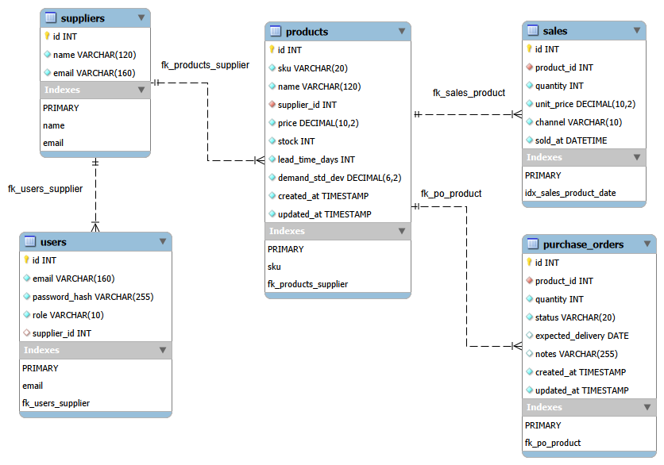

# DemandThread

**Bridging the Demand-Production Gap in Fast Fashion Retail**
BFB 321 Supply Chain Technologies · Final Project · **Group 23**

## Team

| Name | Student number | GitHub username |
|---|---|---|
| Matthew Hattingh | u24720926 | Matthew-BFB321 |
| Iggie Coetzee | u24606805 | u24606805 |
| Jamelio Mannikam | u24570177 | Jamelio-bfb321 |
| Stuart Tyrrell | u24873111 | StuTyrrell |

## Purpose

DemandThread helps a fast-fashion retailer see store and online sales as they happen. It flags any products that are at risk of going out of stock or that will be in excess. It also recommends when and how much to reorder. The buyer can approve orders, and suppliers update the orders in their own portal.

## Structure

Routes to pages are in `app.py`, the JSON API is a Flask Blueprint in `api.py`, all SQL is in `models.py`, and the database connection is in `db.py`. The model for the supply chain is in `supply_chain.py`.

## Database



Five tables: **suppliers**, **products** (each one belongs to a supplier), **sales** and **purchase_orders** (each one belongs to a product), and **users** (buyer or supplier can sign in). All relationships are one-to-many. Alerts, forecasts and reorder quantities are calculated by `supply_chain.py`.

## Setup (Windows)

You need Python, Git and MySQL Server 8 with MySQL Workbench.

1. First, clone the repository and open the folder:
   ```
   git clone https://github.com/Matthew-BFB321/demandthread-group-23.git
   cd demandthread-group-23
   ```
2. Make and then activate a virtual environment, before installing the following:
   ```
   python -m venv venv
   venv\Scripts\activate
   pip install -r requirements.txt
   ```
3. Create the empty database, then in MySQL Workbench, connect to your local server and run:
   ```sql
   CREATE DATABASE demandthread;
   ```
4. Copy `.env.example` to a new file called `.env`:
   ```
   copy .env.example .env
   ```
   Then open `.env` and set `DB_PASSWORD` to your root password for MySQL.
5. Build the tables and load the sample data:
   ```
   python init_db.py
   ```
6. Run the app:
   ```
   python app.py
   ```
   Then open http://127.0.0.1:5000

Run the tests with `python -m pytest`.

## Demo sign-ins

| Role | Email | Password |
|---|---|---|
| Buyer | buyer@demandthread.co.za | Buyer@2026 |
| Supplier (Supplier Portal) | kingsgate@demandthread.co.za | Supplier@2026 |

## API endpoints

All endpoints return JSON. Errors return `{"error": "...", "message": "..."}` with status 400 or 404.

| Method | Path | Purpose | Request | Success |
|---|---|---|---|---|
| GET | /api/kpis | Dashboard KPIs | - | 200 `{sold, sold_change, revenue, revenue_change, stockout, excess, reorders}` |
| GET | /api/products | List products, paged and filtered | `?search=denim&page=1&size=10` (size 1 to 100) | 200 `{page, size, items: [...]}` |
| GET | /api/products/&lt;id&gt; | One product | - | 200 product, or 404 |
| POST | /api/products | Create a product | `{sku, name, supplier_id, price, stock, lead_time_days, demand_std_dev}` | 201 `{message}`; 400 for a duplicate SKU or bad values |
| POST | /api/sales | Record a sale and reduce stock | `{product_id, quantity, channel: "Store" or "Online"}` | 201 `{message}`; 400 if stock is too low |
| GET | /api/alerts | Stockout and excess stock alerts | - | 200 `{stockout: [...], excess: [...]}` |
| GET | /api/forecasts | Next-week forecast per product | - | 200 `[{name, sold, forecast, trend}]` |
| GET | /api/recommendations | Products to reorder, with the recommended quantity | - | 200 `[...]` |
| GET | /api/purchase-orders | List purchase orders, filtered by status | `?status=Placed` | 200 `[...]` |
| POST | /api/purchase-orders | Create a purchase order | `{product_id, quantity, notes}` | 201 `{message}` |
| PATCH | /api/purchase-orders/&lt;id&gt; | Update status, delivery date and notes (Delivered adds to stock) | `{status, expected_delivery: "2026-12-01", notes}` | 200 `{message}`; 400 if already delivered |

## Configuration and logging

`config.py` has development, testing and production settings. These are chosen by `APP_ENV` in `.env`. Errors get logged to `app.log`.

## Reset, backup and rollback

- **To reset to the sample data:** `python init_db.py --reset`
- **To back up before any changes:** `mysqldump -u root -p demandthread > backup.sql`
- **To restore data:** `mysql -u root -p demandthread < backup.sql`
- **To undo failed changes (roll back):** restore the last `backup.sql`, or `git revert <commit>` for a code change.

## Task allocation

| Member | Semester project (Oct) | Final project (Nov) |
|---|---|---|
| Matthew Hattingh | Dashboard and login styling, supply chain model setup and sample data, README | Project foundation (config, db, schema, seed, init_db), Flask app with logging and error handling, API Blueprint, base layout, shared product calculations, dashboard and `/api/kpis`, README |
| Iggie Coetzee | Forecasts page, weekly trend forecast, forecast error and MAPE, product names | Sales and Inventory page, record-sale transaction, product list, detail and create endpoints, `/api/sales` |
| Jamelio Mannikam | Stock alert calculations and tests | Sign-in and roles, Alerts page and `/api/alerts`, Forecasts page, forecast accuracy table and `/api/forecasts`, ERD |
| Stuart Tyrrell | Supplier order table and update form, safety stock, reorder point and EOQ calculations and tests, supplier research | Reorder recommendations, Orders page, purchase orders, Supplier Portal, recommendation and purchase order endpoints |